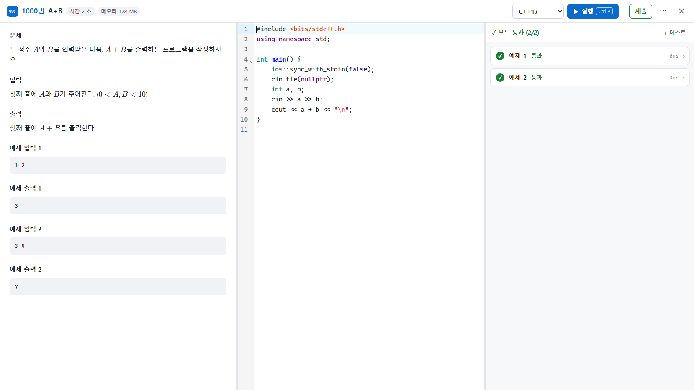
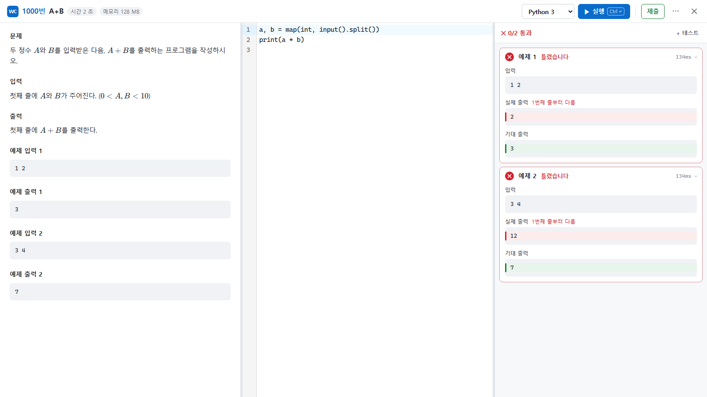
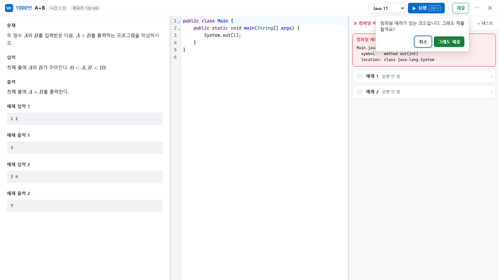
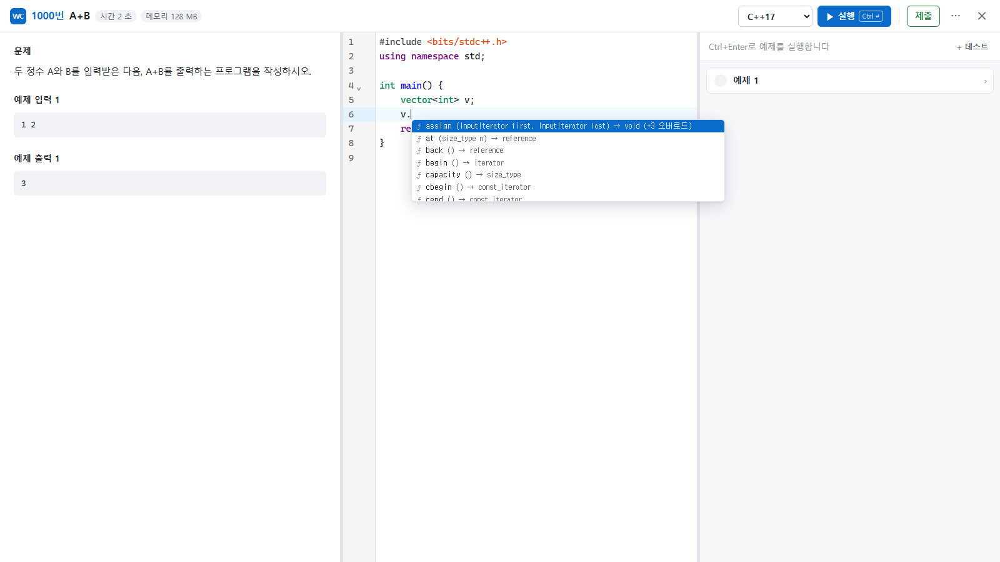
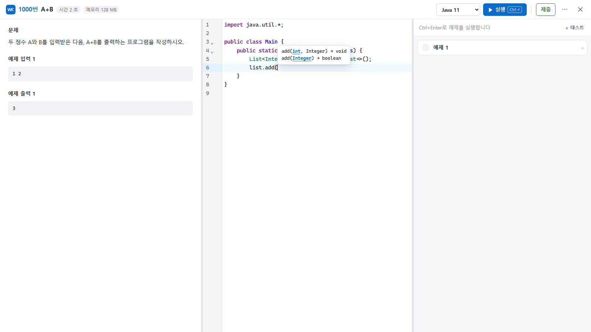
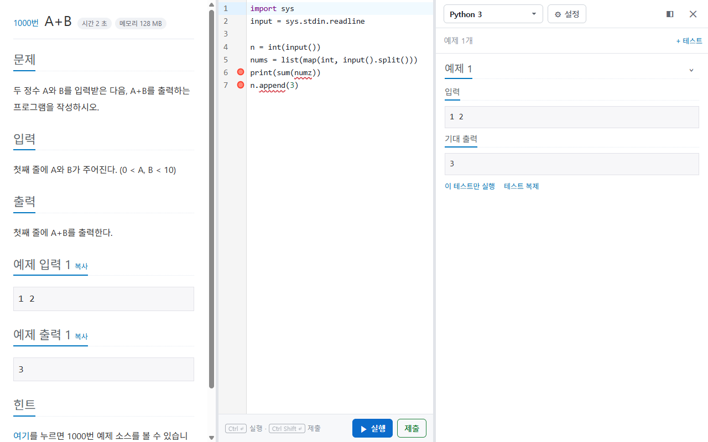

<div align="center">


</div>

# 웹 코더

백준(BOJ) 제출 페이지에서 **문제 보기 → 코드 작성 → 예제 실행·판정 → 제출**을 한 화면에서 끝내는 Chrome 확장입니다.
코드는 외부 서버로 보내지 않고 브라우저 안의 WebAssembly 런타임에서 실행합니다.



| 틀렸을 때: 다른 줄과 글자 표시                 | 제출 전 확인                                        |
| ---------------------------------------------- | --------------------------------------------------- |
|  |  |

## 기능

- 문제 페이지와 제출 페이지의 메뉴에서 **제출** 옆에 **웹 코더로 제출** 탭이 생깁니다. 누르면 BOJ 화면 위에 **문제 | 에디터 | 결과** 작업 공간을 띄우고, ✕를 누르면 BOJ 기본 제출 화면으로 돌아갑니다. (원래 **제출** 탭은 그대로라 BOJ 폼으로 바로 제출할 수도 있습니다)
- 문제 본문과 예제는 문제 페이지(`/problem/*`)를 열 때 저장됩니다. (BOJ는 다른 페이지에서 문제를 불러오는 요청에 본문을 주지 않습니다)
    - 문제 패널은 백준 문제 페이지와 같은 모양으로 보여 줍니다. (제목 밑줄, 예제 입력·출력 나란히, 예제 **복사** 버튼)
    - 그림은 그대로, MathJax 수식은 원문 TeX를 되살려 KaTeX로 그립니다. 상단 ◧ 버튼으로 문제 패널을 접을 수 있습니다.
- 실행 단계(컴파일러 로딩 → 컴파일 → 실행 n/m)를 보여 주고, 끝나면 컴파일 시간과 실행 시간을 나눠 보여 줍니다. 실패한 예제는 자동으로 펼쳐, 다른 줄은 빨간 글씨로, 그 줄에서 실제로 다른 글자는 밑줄로 표시합니다. (공백 하나 차이도 `·`로 보임)
- 실행과 제출 버튼은 에디터 아래에 있습니다. 실행 중에는 경과 시간을 보여 주고, 카드의 **이 테스트만 실행**으로 테스트 하나만 다시 돌릴 수 있습니다.
- 컴파일 에러와 표준 에러의 위치(`main.cpp:3:13`, `File "/main.py", line 3`, `Main.java:12`, `main.js:2:11`)를 누르면 에디터의 그 줄로 갑니다.
- 지금 코드로 예제를 통과하지 않았으면 제출 전에 한 번 확인합니다.
- 로컬 실행
    - **C++**: clang 22 ([YoWASP](https://yowasp.org/)), C++98 ~ C++26(`c++2c`) 표준. `<bits/stdc++.h>` 지원, 언어를 고르면 미리 컴파일된 헤더(PCH)를 만들어 IndexedDB에 저장해 이후 컴파일은 1~2초.
        - 예외(`try/catch/throw`)를 쓰는 코드는 wasi-sdk의 예외 지원 libc++로 링크합니다. 잡히지 않은 예외는 GCC처럼 `terminate called after throwing an instance of ...`로 알려 줍니다.
        - GCC 전용 기능 중 풀이에서 흔한 것을 지원합니다: `__gcd`, `__lg`, `<bits/extc++.h>`, pb_ds의 `tree`(`order_of_key`, `find_by_order`)와 `gp_hash_table`/`cc_hash_table` (대체 구현)
        - LTO로 링크해서 `long long dp[5001][5001]` 같은 큰 전역 배열이 있어도 컴파일이 느려지지 않습니다.
        - wasm용 libc++의 `cin`이 매우 느려서 정수 파서를 교체해 넣고, `sync_with_stdio(false)`를 쓰면 `cin`/`cout`에 64KB 버퍼를 붙입니다. (정수 100만 개 읽기 2.1초 → 0.3초)
        - 전역 변수 이름이 libc 함수(`link`, `access` 등)와 겹쳐 링크가 실패하면 이름을 바꿔 자동으로 다시 컴파일합니다.
    - **Python 3**: CPython 3.13 WASI 빌드. 순수 Python 재귀는 깊이 70만까지 확인. `lru_cache` 재귀처럼 C 코드를 거치는 재귀는 약 1,600에서 `RecursionError`가 납니다. 출처와 한계는 [tools/python/README.md](./tools/python/README.md)
    - **node.js**: sandbox 페이지의 워커에서 Chrome V8로 직접 실행. Node처럼 모듈 함수로 감싸 실행하고(최상위 `return`, `__dirname`), `fs.readFileSync('/dev/stdin')`(인코딩이 없으면 `Buffer`), `readline`, `process.exit`, `Buffer`, `path`·`assert`·`events`·`util` 모듈을 지원합니다. `console.log`의 객체·배열 출력 형식도 Node와 같습니다.
        - 백준은 `node --stack-size=65536`으로 실행하지만 브라우저 워커는 스택을 늘릴 수 없어 재귀가 수천에서 막힙니다. 그때는 C 스택을 크게 잡아 직접 빌드한 QuickJS로 자동으로 다시 실행합니다. (깊이 약 60만, [tools/quickjs/README.md](./tools/quickjs/README.md))
    - **Java**: OpenJDK javac + [TeaVM](https://teavm.org)을 wasm으로 빌드한 [teavm-javac](https://github.com/konsoletyper/teavm-javac)로 컴파일하고 WebAssembly(GC)로 실행. `Scanner`, `BufferedReader`/`BufferedWriter`, 컬렉션, `record`, `Thread`(`new Thread(null, r, "", 1 << 26)` 포함) 등 지원. 잡히지 않은 예외와 `printStackTrace()`는 JVM처럼 `at Main.solve(Main.java:12)` 형식의 스택 트레이스를 보여 주고, 컴파일 에러에는 javac처럼 해당 소스 줄과 위치(`^`)가 붙습니다. 빌드·패치 방법은 [tools/java/README.md](./tools/java/README.md)
- **깊은 재귀**: 브라우저는 호출 스택이 약 1MB로 고정이라 재귀가 수천 단계에서 죽습니다. 스택이 넘치면 wasm을 고쳐 JSPI로 스택을 이어 붙이는 모드로 자동으로 다시 실행합니다. (C++·Java·Python 깊이 100만, node.js 약 60만 확인. Chrome 137 이상. 원리는 [src/runner/deep-stack.ts](./src/runner/deep-stack.ts))
- 예제 자동 판정 (BOJ처럼 줄 끝 공백·마지막 빈 줄 무시), stdout/stderr 분리
- 스페셜 저지 문제는 본문에서 허용 오차(예: 10<sup>-9</sup>)를 찾아, 실수 출력을 그 오차 안에서 비교합니다. 오차를 못 찾으면 출력만 보여 줍니다.
- C++·Python은 메모리 사용량을 보여 주고, 백준의 언어별 메모리 제한(Python ×2+32MB, PyPy3 ×2+128MB 등)을 넘으면 알려 줍니다. (wasm 기준 근삿값이라 판정은 바꾸지 않음)
- 시간 초과 시 실행 워커를 강제 종료하므로 무한 루프에도 멈추지 않고, 그때까지의 출력은 보여 줍니다.
- 로컬 시간 제한은 BOJ의 언어별 보정(Java ×2+1초, Python·node.js ×3+2초)을 따르고, 끝까지 돌았더라도 그 제한보다 오래 걸리면 알려 줍니다.
- 커스텀 테스트(예제를 **테스트 복제**로 가져와 고치기), 문제·언어별 코드 자동 저장, 언어별 **내 템플릿**, 패널 크기 저장
- 설정(오른쪽 위 ⚙ 설정)
    - 에디터 테마 43종: VS Code 내장 19종, JetBrains 8종, Rider·ReSharper 9종, Visual Studio 2종, 그 밖에 GitHub·Dracula·Nord·One Dark. 설치된 편집기의 테마 파일에서 색을 뽑은 것입니다([tools/themes/README.md](./tools/themes/README.md)). 테마는 에디터에만 적용됩니다.
    - 화면 밝기(시스템 설정 따름 / 밝게 / 어둡게)
    - 글꼴: PC에 설치된 코딩 글꼴을 찾아 보여 주고, 직접 입력하거나 PC의 모든 글꼴을 불러올 수 있습니다. (글꼴 파일을 받지 않음)
    - 글자 크기, 자동 줄바꿈, 소스 코드 공개 범위, 내 템플릿 저장
- 단축키: `Ctrl+Enter` 실행, `Ctrl+Shift+Enter` 제출, `Ctrl+Space` 자동완성, `Ctrl+B` 문제 패널 접기
- 제출은 BOJ 원래 폼에 코드를 채워 원래 제출 버튼으로 보냅니다. (reCAPTCHA 등 BOJ의 제출 절차를 그대로 따름)

## 인텔리센스

자동완성, 함수 시그니처 힌트, 실시간 에러 밑줄을 모든 언어에서 지원합니다. 서버 없이 브라우저 안에서 분석합니다.

| C++ 멤버 자동완성                                 | Java 시그니처 힌트                                   | Python 실시간 진단                                  |
| ------------------------------------------------- | ---------------------------------------------------- | --------------------------------------------------- |
|  |  |  |

| 언어    | 엔진                                                                                                    | 자동완성      | 시그니처 | 실시간 진단 | 호버 |
| ------- | ------------------------------------------------------------------------------------------------------- | ------------- | -------- | ----------- | ---- |
| C++     | 실행용 clang 22 그대로 (`-code-completion-at`, `-fsyntax-only`)                                         | ✓ (의미 기반) | ✓        | ✓           | –    |
| node.js | TypeScript 언어 서비스 (JS + Node 타입)                                                                 | ✓             | ✓        | ✓           | ✓    |
| Python  | Pyright ([@typefox/pyright-browser](https://www.npmjs.com/package/@typefox/pyright-browser)) + typeshed | ✓             | ✓        | ✓           | ✓    |
| Java    | javac(진단) + JDK 시그니처 색인으로 타입 추론 (`sc.`, `list.get(0).`, `System.out.` 등)                 | ✓             | ✓        | ✓           | ✓    |

- Java는 IntelliJ식 라이브 템플릿을 제공합니다: `sout`, `fori`, `br`, `st`, `pint`, `sb`, `psvm`
- C++는 `bits/stdc++.h` PCH가 만들어진 뒤로 자동완성 0.1초, 진단 0.2초 안팎으로 응답합니다. (처음 한 번은 PCH를 만드느라 몇 초 걸림)

## 구조

```text
src/
├─ content/
│  ├─ boj.ts         # content script: 문제/폼 정보 수집, 솔버 iframe 삽입, 제출 중계
│  ├─ boj-main.ts    # MAIN world 스크립트: 페이지의 CodeMirror/폼 조작
│  └─ problem.ts     # 문제 페이지 HTML 파싱
├─ solver/           # iframe 안의 UI (확장 페이지, 바닐라 TS + CodeMirror 6)
│  ├─ solver.ts      # 진입점: 상태, 실행·제출 흐름
│  ├─ editor-settings.ts / fonts.ts # 설정 창 (테마, 화면 밝기, 글꼴)
│  ├─ tests-view.ts  # 예제·내 테스트 카드, 출력 비교
│  └─ problem-view.ts # 문제 패널 (정화 + KaTeX)
├─ runner/
│  ├─ pool.ts        # 워커 풀, C++ 컴파일 캐시, 시간 제한
│  ├─ worker.ts      # 실행 워커 진입점
│  ├─ compiler-worker.ts # C++ 컴파일·인텔리센스 (YoWASP clang, PCH 캐시)
│  ├─ cpp.ts / python.ts   # 결과물/파이썬 실행 (WASI)
│  ├─ node-deep.ts   # node.js 깊은 재귀 모드 (QuickJS WASI)
│  ├─ deep-stack.ts  # 깊은 재귀 모드: wasm 후처리 + JSPI 스택 전환 (C++, Java, Python, QuickJS)
│  ├─ jspi.ts        # JSPI 지원 여부, 스택 한계 에러 판별
│  ├─ java-debug.ts  # Java 스택 트레이스: 결과물의 디버그 정보로 주소 → 클래스·메서드·줄 번호
│  ├─ cpp-header.ts / cpp-pbds.ts # bits/stdc++.h, 빠른 입출력, GCC 호환 헤더
│  ├─ wasi.ts        # WASI 실행, 기본 파일 시스템 캐시
│  └─ tar.ts         # tar 파서
├─ sandbox/          # node.js 실행용 sandbox 페이지 (eval 허용, extension API 없음)
├─ intel/            # 인텔리센스 엔진 (C++ clang, TS 서비스, Pyright, Java 색인)
├─ judge/            # 출력 비교, 실수 오차 비교
└─ shared/           # 언어 매핑, 메시지 프로토콜
build.ts             # esbuild 번들 + manifest 생성
public/wasm/         # python, QuickJS 바이너리와 기본 파일 시스템 (clang은 npm @yowasp/clang에서 복사, 빌드 때 gzip)
public/clang-eh/     # C++ 예외 지원 libc++/libc++abi/libunwind (wasi-sdk 33, tools/cpp/README.md)
```

UI는 BOJ 페이지 안의 `chrome-extension://` iframe에서 돌아갑니다. 그래서 BOJ CSS와 충돌하지 않고, 실행용 Worker를 띄울 수 있습니다.
BOJ에서 받은 문제 HTML은 DOMPurify로 정화한 뒤 렌더링합니다.

## 개발

Node 22.18 이상이 필요합니다 (TS 파일을 바로 실행).

```bash
npm install
npm run build      # dist/ 생성
npm run watch      # 변경 감시 빌드
npm test           # node --test
npm run typecheck
npm run lint
npm run package    # 웹 스토어용 zip (release/)
```

`chrome://extensions`에서 개발자 모드를 켜고 `dist`를 "압축해제된 확장 프로그램"으로 로드합니다.

## 라이선스

[LICENSE.md](./LICENSE.md)
