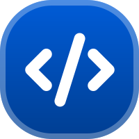

<div align="center">



</div>

# 웹 코더

백준(BOJ) 제출 페이지에서 **문제 보기 → 코드 작성 → 예제 실행·판정 → 제출**을 한 화면에서 끝내는 Chrome 확장입니다.
코드는 외부 서버로 보내지 않고 브라우저 안의 WebAssembly 런타임에서 실행합니다.


| 틀렸을 때: 처음 다른 줄부터 비교 | 제출 전 확인 |
| --- | --- |
|  |  |

## 기능

- `/submit/*` 페이지에서 BOJ 화면 위에 **문제 | 에디터 | 결과** 작업 공간을 띄웁니다. ✕를 누르면 BOJ 기본 화면으로 돌아갑니다.
- 문제 본문과 예제는 문제 페이지(`/problem/*`)를 열 때 저장됩니다. (BOJ는 다른 페이지에서 문제를 불러오는 요청에 본문을 주지 않습니다)
- 실행 단계(컴파일러 로딩 → 컴파일 → 실행 n/m)를 보여 주고, 실패한 예제는 자동으로 펼쳐 줄 단위로 비교합니다.
- 지금 코드로 예제를 통과하지 않았으면 제출 전에 한 번 확인합니다.
- 로컬 실행
  - **C++**: clang 22 ([YoWASP](https://yowasp.org/)), C++11 ~ C++26(`c++2c`) 표준. `<bits/stdc++.h>` 지원, 처음 한 번 미리 컴파일된 헤더(PCH)를 만들어 IndexedDB에 저장해 이후 컴파일은 1초 이내. 예외(`try/catch`)는 아직 지원하지 않습니다.
    - wasm용 libc++의 `cin`이 매우 느려서 정수 파서를 교체해 넣고, `sync_with_stdio(false)`를 쓰면 `cin`/`cout`에 64KB 버퍼를 붙입니다. (정수 100만 개 읽기 2.1초 → 0.3초)
    - 전역 변수 이름이 libc 함수(`link`, `access` 등)와 겹쳐 링크가 실패하면 이름을 바꿔 자동으로 다시 컴파일합니다.
  - **Python 3**: CPython 3.11 WASI 빌드. 재귀 깊이 10⁶까지 확인. 네이티브 CPython보다 3~4배 느립니다.
  - **node.js**: sandbox 페이지의 워커에서 Chrome V8로 직접 실행. `fs.readFileSync('/dev/stdin')`, `readline`, `process.exit` 지원
  - **Java**: OpenJDK javac + [TeaVM](https://teavm.org)을 wasm으로 빌드한 [teavm-javac](https://github.com/konsoletyper/teavm-javac)로 컴파일하고 WebAssembly(GC)로 실행. `Scanner`, `BufferedReader`/`BufferedWriter`, 컬렉션, `record` 등 지원. 브라우저 Worker 스택 한계로 재귀 깊이 약 4천~9천을 넘으면 `StackOverflowError`. 빌드·패치 방법은 [tools/java/README.md](./tools/java/README.md)
- 예제 자동 판정 (BOJ처럼 줄 끝 공백·마지막 빈 줄 무시), 처음 다른 줄 표시, stdout/stderr 분리
- 시간 초과 시 실행 워커를 강제 종료하므로 무한 루프에도 멈추지 않습니다.
- 커스텀 테스트, 문제·언어별 코드 자동 저장, 패널 크기 저장, 다크 모드
- 단축키: `Ctrl+Enter` 실행, `Ctrl+Shift+Enter` 제출
- 제출은 BOJ 원래 폼에 코드를 채워 원래 제출 버튼으로 보냅니다. (reCAPTCHA 등 BOJ의 제출 절차를 그대로 따름)

## 구조

```text
src/
├─ content/
│  ├─ boj.ts         # content script: 문제/폼 정보 수집, 솔버 iframe 삽입, 제출 중계
│  ├─ boj-main.ts    # MAIN world 스크립트: 페이지의 CodeMirror/폼 조작
│  └─ problem.ts     # 문제 페이지 HTML 파싱
├─ solver/           # iframe 안의 UI (확장 페이지, 바닐라 TS + CodeMirror 6)
├─ runner/
│  ├─ pool.ts        # 워커 풀, C++ 컴파일 캐시, 시간 제한
│  ├─ worker.ts      # 실행 워커 진입점
│  ├─ compiler-worker.ts # C++ 컴파일 (YoWASP clang, PCH 캐시)
│  ├─ cpp.ts / python.ts   # 결과물/파이썬 실행 (WASI)
│  ├─ wasi.ts        # WASI 실행, 기본 파일 시스템 캐시
│  └─ tar.ts         # tar 파서
├─ sandbox/          # node.js 실행용 sandbox 페이지 (eval 허용, extension API 없음)
├─ judge/            # 출력 비교
└─ shared/           # 언어 매핑, 메시지 프로토콜
build.ts             # esbuild 번들 + manifest 생성
public/wasm/         # python 바이너리와 기본 파일 시스템 (clang은 npm @yowasp/clang에서 복사)
```

UI는 BOJ 페이지 안의 `chrome-extension://` iframe에서 돌아갑니다. 그래서 BOJ CSS와 충돌하지 않고, 실행용 Worker를 띄울 수 있습니다.
BOJ에서 받은 문제 HTML은 DOMPurify로 정화한 뒤 렌더링합니다.

## 개발

Node 22.18 이상이 필요합니다 (TS 파일을 바로 실행).

```bash
npm install
npm run build      # dist/ 생성
npm run watch      # 변경 감시 빌드
npm test           # node --test
npm run typecheck
npm run lint
```

`chrome://extensions`에서 개발자 모드를 켜고 `dist`를 "압축해제된 확장 프로그램"으로 로드합니다.

## 라이선스

[LICENSE.md](./LICENSE.md)
